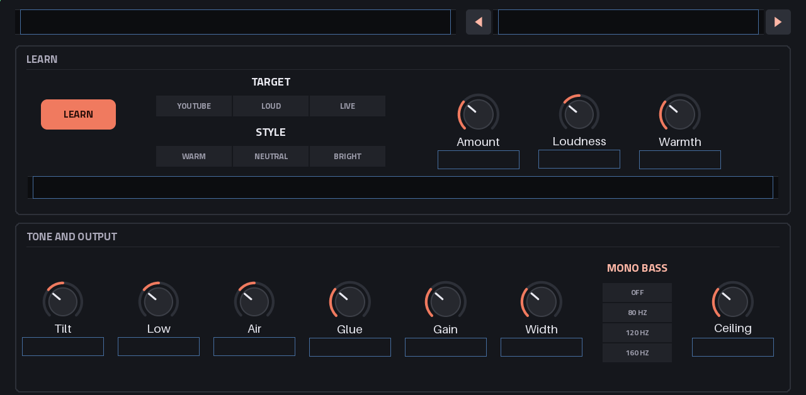

# MasterWerk

**The last insert on the Akai Force's master: the end of the chain while you play, and a master good
enough for a YouTube upload after one press.**

*Formerly MasterForce.* <!-- werk-rename: keep -->

A VST2 insert effect for MPC OS's built-in plugin host, a sibling of
[EffectWerk](https://github.com/Devko/EffectWerk), [PolyWerk](https://github.com/Devko/PolyWerk)
and [SubWerk](https://github.com/Devko/SubWerk) on the same groundwork. Without setup it never lets
the master clip and changes nothing below its ceiling. Press LEARN, play the loudest 8 bars, and it
sets a broad tone, a little glue and the gain for a loudness target (YouTube −14 LUFS, Loud −10),
under a true-peak limiter at −1 dBTP. A safe finisher, not a mastering engineer.

> [!NOTE]
> **Preview (0.0.x).** The plugin, its pages and presets are built and pass the full suite on x86 and
> under ARM emulation; it has not been played on a Force yet. The parameter list may still change
> before v0.1.



*The MASTER page, rendered offline from the skin (on the device MPC fills in the values).*

## The chain

```
IN → Tone → Glue → Gain → Warmth → Width / mono bass → Clipper (2×) → Limiter (true peak) → OUT
```

| Stage | |
|---|---|
| Tone | Tilt, Low (80 Hz), Air (10 kHz): broad shelves only |
| Glue | A gentle 2:1 compressor; its threshold comes from the measurement, its makeup keeps the level |
| Gain | To the target, set by LEARN |
| Warmth | Tube saturation, level-compensated: even harmonics and a little density (off by default) |
| Width / mono bass | The side's level; the low end in the middle (80, 120 or 160 Hz) |
| Clipper | Shaves the fastest peaks before the limiter, only while the chain drives |
| Limiter | Look-ahead (64 samples, 1.45 ms), true peak, −1 dBTP |

## Documentation

| Document | What's in it |
|---|---|
| [User guide](docs/USER_GUIDE.md) | Where it goes, LEARN, the knobs, the meters, exporting for YouTube, presets |
| [Design](docs/DESIGN.md) | What it is and why: the chain, LEARN's rules, the STYLE curves, the glue rule, warmth |
| [Changelog](CHANGELOG.md) | What changed in each release |

## Requirements

- An **Akai Force** (other first-generation MPC OS devices may work; untested), **MPC OS 3.x**.
- **Root SSH access** to the device (for example through MockbaMod): stock MPC OS has no way to
  install third-party plugins.

## Installation

Download a release package (`MasterWerk-<version>-mpc-armv7.zip`) or build one with
`make plugin-package`, unzip it and follow the `INSTALL.md` inside:

```sh
scp -r MasterWerk-<version> root@<device-ip>:/tmp/
ssh -t root@<device-ip> sh /tmp/MasterWerk-<version>/install.sh
```

The installer asks for confirmation, **stops MPC** (save your project first), copies the plugin,
backs up and edits `MPC.settings`, and starts MPC again. Then put **MasterWerk** on the master's
last insert.

## Building

Linux or WSL, as for EffectWerk:

```sh
make test                  # the chain and the plugin under ASan/UBSan
make test-arm              # the same suite built for the Force, under qemu-arm
make arm-plugin            # build/arm/masterwerk.so (profile-guided where qemu-arm runs)
make skin preview          # the skin, and every page as surface/build/page_*.png
make plugin-package        # dist/MasterWerk-<version>-mpc-armv7.zip
make plugin-install        # onto the Force (FORCE=root@<ip> in local.mk); restarts MPC
make bench-device          # CPU on the Force
make proto                 # build/mfproto: the chain offline on a WAV (master, analyze)
```

`surface/surface.py` is the single source of the parameter list, the pages and the factory presets'
checks. Release packages come from CI ([`.github/workflows/build.yml`](.github/workflows/build.yml)):
the device build in `arm32v7/gcc:11-bullseye` (glibc 2.31) under QEMU, profile-guided, checked with
the plugin catalog's `catalog_check.py`; a `vX.Y.Z` tag publishes it with its CHANGELOG section.

## License

MIT, see [LICENSE](LICENSE). `dsp/` holds EffectWerk's shared pieces (simd, fastmath, the SVF, the
halfbands, EQ, Comp, Drive) as they were at its 0.0.2; `plugin/` and `surface/` are its plugin layer
cut down to one chain; `third_party/mpc-vst-plugins/` is sd88me's skin generator and installer (MIT),
vendored with PolyWerk's patches.

## Trademarks

Not affiliated with or endorsed by inMusic Brands or Akai Professional. Akai Professional, Akai Force and MPC
are trademarks of their respective owners.
